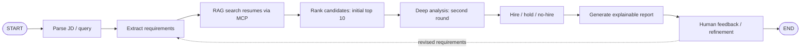

# LangGraph resume matching agent

An explainable recruiting assistant that reads resumes exclusively through the included MCP filesystem server. It parses job requirements, performs lightweight lexical RAG retrieval, ranks an initial top 10, performs a second evidence-based screen, and produces final hire/hold/no-hire recommendations.

## Architecture

`matching_agent.py` contains `AgentState`, which persists conversation history, parsed job requirements, candidate data, shortlist, scoring rationale, screening results, recommendations, and human feedback. The production graph is built with LangGraph's `StateGraph`; a dependency-free compatibility runner allows a classroom demo before installing dependencies.



The graph's node sequence is `START → parse_jd → extract_requirements → search_resumes → rank_candidates → deep_analysis → final_recommendations → generate_report → human_feedback → END`. In chat mode, feedback is appended to the saved JD and invokes a new graph run, making re-ranking explicit and reproducible.

## Setup and run

```bash
python3 -m pip install -r requirements.txt
python3 matching_agent.py "Find candidates with React and 3+ years experience" --root resumes
python3 matching_agent.py --root resumes --chat
python3 -m unittest -v
```

Example chat queries:

```text
Find me candidates with React and 3+ years experience
Compare R012, R043, and R081 side by side
Why did R012 rank higher?
Require TypeScript and at least 5 years
questions for R012
```

## Agent tools

- `extract_requirements(jd)` separates must-have skills, nice-to-have skills, and the requested minimum experience.
- `compare_candidates(candidate_ids)` gives a concise head-to-head comparison with scores, strengths, and gaps.
- `generate_interview_questions(candidate_id)` turns demonstrated strengths and missing criteria into screening questions.

The candidate score weights must-have evidence (55%), nice-to-have evidence (15%), experience (20%), and role-title relevance (10%). Each result exposes strengths, gaps, a plain-language ranking explanation, and a recommendation. Borderline candidates receive `HOLD / INTERVIEW`, making the areas to verify clear instead of silently discarding them.

## Test scenarios

`test_conversation_flows.py` contains six end-to-end flows: requirement extraction, candidate search, top-candidate comparison, ranking explanation, iterative refinement/re-ranking, and interview-question generation. `test_mcp_workflow.py` continues to test MCP protocol, path protection, fault-tolerant batch reads, and the backwards-compatible ranking API.

For a recording-ready walkthrough with the exact prompts and the explainability details to show, see [VIDEO_DEMO.md](VIDEO_DEMO.md).
